<p align="center">
  <a href="README.md">🇫🇷 Français</a> &nbsp;·&nbsp; <b>🇬🇧 English</b>
</p>

<p align="center">
  
</p>

<p align="center">
  <b>The neumorphic music player for your Emby server</b><br>
  Installable web app (PWA) &nbsp;·&nbsp; Android app &nbsp;·&nbsp; Offline playback &nbsp;·&nbsp; French / English
</p>

<p align="center">
  <a href="https://github.com/PetitOursManu/Soundy/releases/latest"><b>📱 Download the Android APK</b></a>
  &nbsp;·&nbsp;
  <a href="#install-coolify"><b>☁️ Install the web version</b></a>
  &nbsp;·&nbsp;
  <a href="#whats-new"><b>🆕 What's new</b></a>
</p>

---

## 📸 Screenshots

### Mobile

<table>
  <tr>
    <td align="center">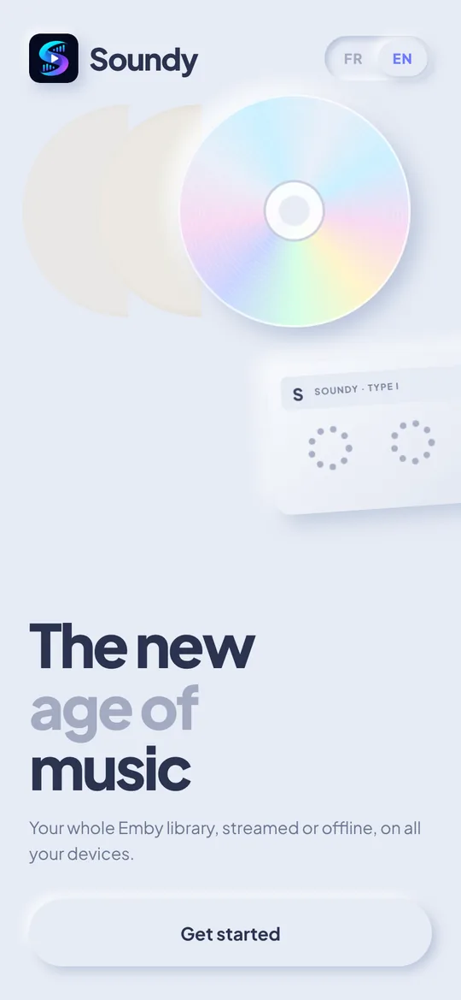<br><sub>Welcome</sub></td>
    <td align="center">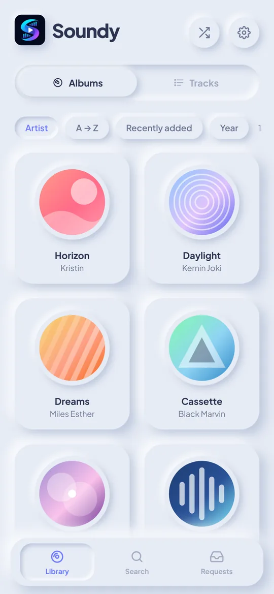<br><sub>Library (albums)</sub></td>
    <td align="center">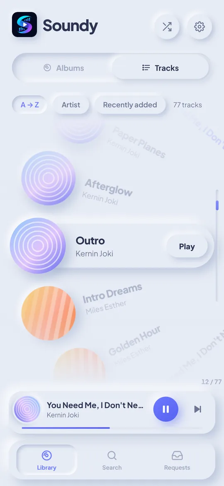<br><sub>Track wheel</sub></td>
    <td align="center">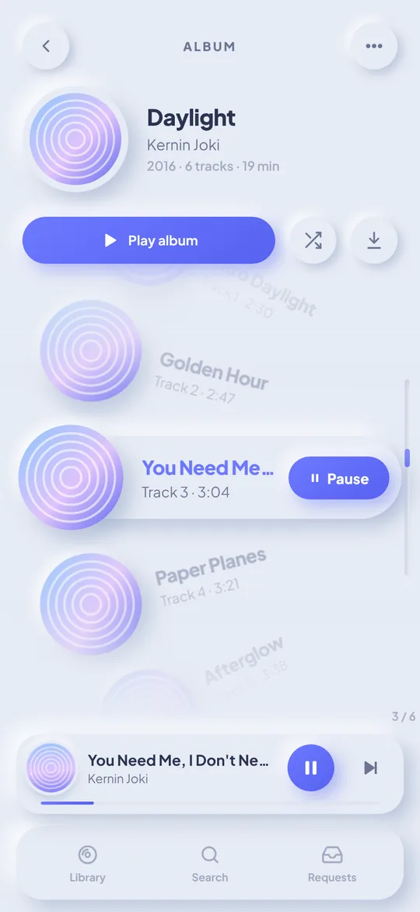<br><sub>Album</sub></td>
  </tr>
  <tr>
    <td align="center">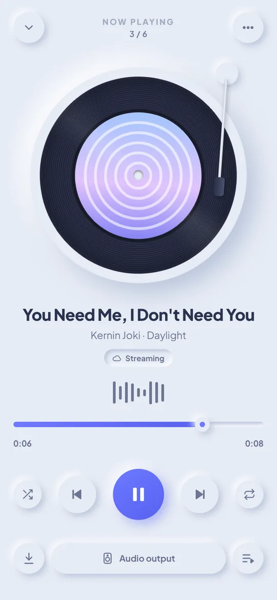<br><sub>Player</sub></td>
    <td align="center">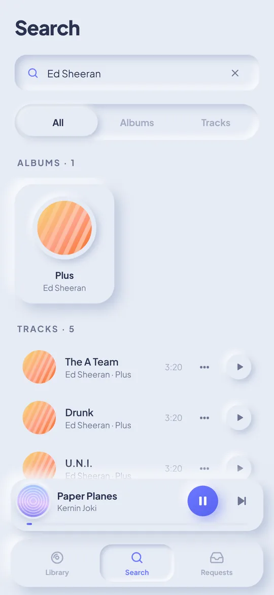<br><sub>Search (artist)</sub></td>
    <td align="center">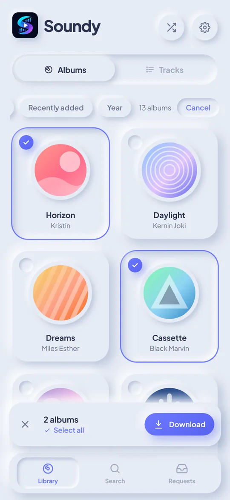<br><sub>Album selection</sub></td>
    <td align="center">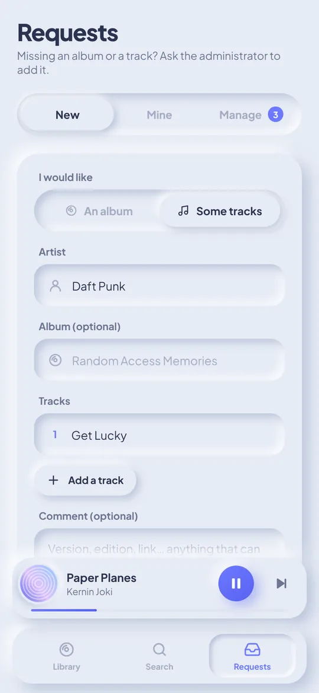<br><sub>Music requests</sub></td>
  </tr>
  <tr>
    <td align="center">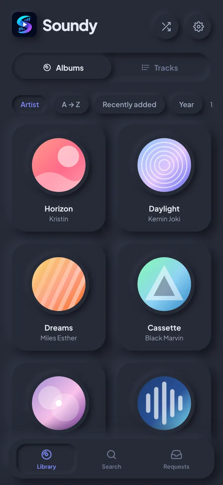<br><sub>Dark theme</sub></td>
    <td align="center">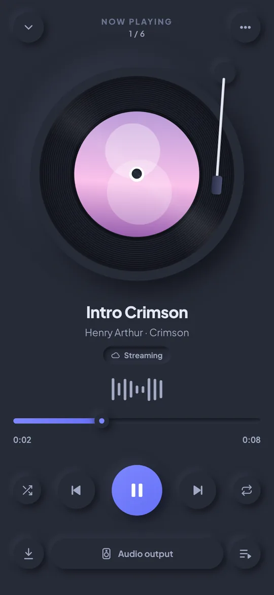<br><sub>Player (dark)</sub></td>
    <td></td>
    <td></td>
  </tr>
</table>

### Web (desktop)

<p align="center">
  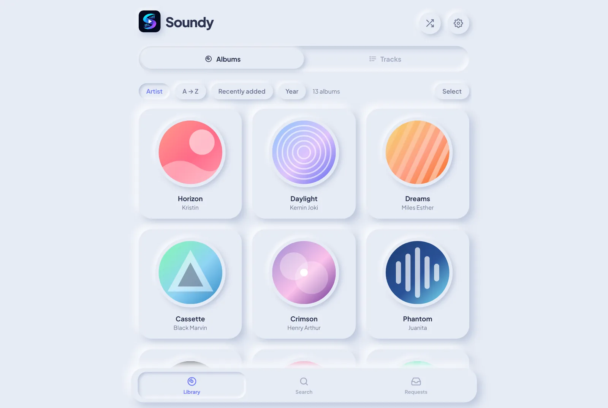<br><sub>Library</sub>
</p>
<p align="center">
  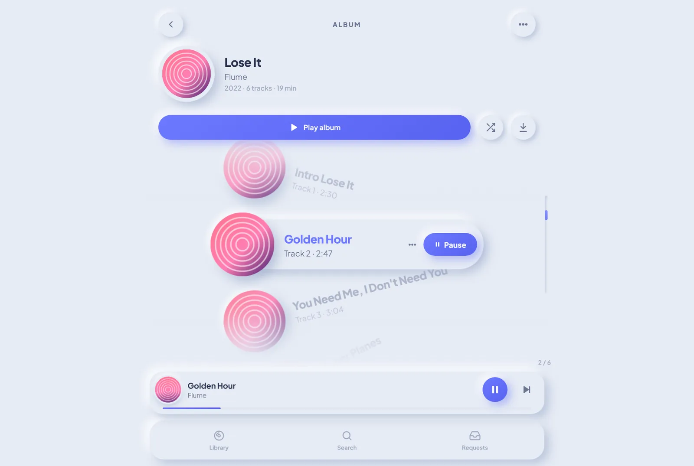
  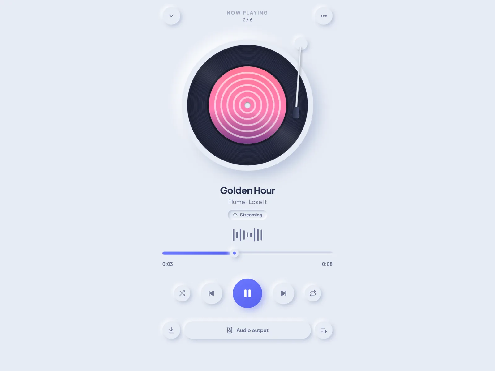
</p>
<p align="center"><sub>Album (mouse wheel / arrow-key navigation) &nbsp;·&nbsp; Full-screen player</sub></p>

> Screenshots taken with a demo library.

---

## ✨ Features

| Feature | Details |
|---|---|
| 🎵 Emby streaming | Play your whole Emby music library, adjustable quality (lossless → 128 kbps). |
| 📥 Downloads | On every album / track, or **several albums at once** (*Select* button or long press). **A downloaded track is always played from the device first**, even when online. Storage used and deletion in Settings. |
| 💿 Library | **Albums by default**, sorted **by artist then alphabetically**, or a **track-by-track** view. Albums "split" by Emby (different album artist from one track to another) are **merged automatically**. |
| 🎡 Wheel navigation | In an album and in the Tracks view, songs scroll along a circle and the centred track is highlighted. **Desktop**: mouse wheel / trackpad, arrow keys, Page ↑/↓, Home/End, Enter. **Mobile**: swipe. Track menu: right-click / long press. |
| ❤ Favorites | By **track** and by **album** (❤ on the album page, in the wheel, the player and a track's menu); **"Favorites"** filter in the library. These are your **Emby** favorites: synced with your other devices and Emby apps. |
| 🔍 Search | By **album**, **track** and **artist** (All / Albums / Tracks filters), recent searches. |
| 🎧 Bluetooth | Bluetooth headphones / speakers, name of the connected device (Android), output selection (browser), headset / car buttons. **Screen-off playback** with a control notification (Android). |
| 📳 Vibrations | Gentle haptic feedback when scrolling through tracks and on buttons (can be turned off). |
| 📨 Requests | Ask the admin to add **a whole album** or **several tracks**; the admin approves / declines with a message. The admin can be **notified on their phone** (ntfy, Discord, Gotify… — [see the guide](#notifications)). |
| 🌍 Languages | **French and English**, chosen on first launch, changeable in Settings and on the sign-in screen. |
| 🌗 Theme | Light, dark or automatic, neumorphic style. |
| 🔄 Updates | Automatic GitHub release for each new version; the APK installs **over** the previous one (downloads are kept). |

---

<a id="whats-new"></a>

## 🆕 What's new

| Version | Changes |
|---|---|
| **1.5.6** | Mini player: when the track is paused, swipe it down to dismiss it (playback is stopped). |
| **1.5.5** | Navigation bar: download count badge next to the Library icon, both centred. Track wheel: Play and ❤ buttons removed (tap the centred track to play it), translucent ❤ in the centre of each track's cover (pink when favourited). |
| **1.5.4** | Android: signed APK and release published from `main` only (the signing key is no longer given to other branches); test APKs from branches are signed with a throwaway key. |
| **1.5.3** | Android: status bar and navigation bar match the chosen theme (light / dark / automatic), with readable icons. |
| **1.5.2** | Mobile: the curved scrollbar no longer overlaps the tracks (space reserved to the right of the wheel). |
| **1.5.1** | Logo: the "S" now stands on its own, with no block around it, in the header, login screen and Settings. |
| **1.5.0** | Turntable arm moving across the record as the track plays. Curved scrollbar following the track wheel. Server: more tolerant `EMBY_URL` (`/emby` suffix detected, spaces / quotes ignored), `/api/health` diagnostics, precise error messages. Requests tab: the entered address is used immediately. |
| **1.4.2** | Artwork shown for albums without their own image in Emby (taken from a track). Reliable artist sort: albums by the same artist side by side ("feat.", case and accent variants grouped), then alphabetical order. |
| **1.4.1** | Simpler request notifications: service detected automatically (ntfy, Discord, Gotify, Slack), test button in Settings (admin), guide in the README. |
| **1.4.0** | **Favorites** by track and by album (synced with Emby), "Favorites" filter in the library (albums and tracks). |
| **1.3.0** | **English version** of the app: language picker on first launch, in Settings and on the sign-in screen (interface, Android notification, server error messages). English README. |
| **1.2.2** | New logo (icons, splash screen, header). Touch scrolling restored when the finger starts on an album card. |
| **1.2.1** | No more stretch / bounce effect at the top and bottom of pages. |
| **1.2.0** | Gentle vibrations (wheel, buttons, long presses). Requests page fixed in the Android app (server address entered on the page). Sharp splash screen, sign-in without scrolling, roomier mini player and player buttons, tonearm on the record, albums sorted by artist. |
| **1.1.0** | Split albums merged, selection and download of several albums, artist search, Android back button, softer fade under the header, **APK signed with a fixed key** (updates keep downloads). |
| **1.0.0** | First version: Emby streaming, offline downloads, wheel navigation, vinyl player, Bluetooth, music requests, PWA and Android APK. |

---

## 🔑 Credentials

**There are no default credentials**: Soundy has no accounts of its own.
You sign in with an **Emby user account**:

| Field | Value |
|---|---|
| Emby server address | Your Emby URL, e.g. `https://emby.mydomain.com` (Soundy also tries `…/emby` automatically) |
| Username | Your Emby username |
| Password | Your Emby password |

- An **Emby administrator** is automatically an administrator in Soundy (*Requests → Manage* tab).
- To add a user: create them in Emby (*Dashboard → Users*), nothing to do in Soundy.
- To allow downloads: tick **"Allow media downloading"** in their Emby permissions.

---

## 🧱 Architecture

```
┌──────────────────────┐        ┌───────────────────────────┐
│  Soundy (web/Android)│──API──▶│  Emby (music, artwork)    │
│  React + Vite        │        └───────────────────────────┘
│  IndexedDB (offline) │                     ▲ checks the token
│                      │──API──▶┌────────────┴──────────────┐
└──────────────────────┘        │  Soundy server (Node.js)  │
                                │  - requests API           │
                                │  - serves the web app     │
                                │  - Emby proxy (optional)  │
                                └───────────────────────────┘
```

- **Sign-in**: each user signs in with **their own Emby account**. Emby administrators are automatically administrators in Soundy (request management).
- **Requests**: stored in `data/requests.json` on the Soundy server. The server checks every call with Emby: nobody can impersonate another user.
- **Downloads**: stored in the browser / WebView (IndexedDB), together with the artwork.

```
src/
  api/emby.ts          Emby API client (sign-in, albums, tracks, search, audio streams)
  api/requests.ts      Requests API client
  i18n/                Translations (fr.ts, en.ts) — the build fails if an English key is missing
  store/player.ts      Player (queue, shuffle, repeat, local-first playback, MediaSession)
  store/downloads.ts   Download manager (queue, progress, storage)
  lib/db.ts            IndexedDB storage (audio, artwork, metadata)
  lib/nativeBridge.ts  Bridge to the Android service (notification, Bluetooth buttons)
  lib/albums.ts        Merging of albums "split" by Emby
  lib/haptics.ts       Vibrations (haptic feedback)
  lib/backButton.ts    Android back button
  components/TrackWheel.tsx  Wheel navigation (mouse wheel, keyboard, swipe)
  pages/               Library, Album, Player, Search, Requests, Settings, language picker
  styles/global.css    Neumorphic design system (light / dark themes)
server/index.js        Soundy server (Express)
android/               Android project (Capacitor) + native SoundyAudio plugin
```

---

<a id="install-coolify"></a>

## ☁️ Install on Coolify

1. **+ New → Resource → Private Repository (with GitHub App)** (or *Public Repository*), pick the `Soundy` repository, branch **`main`**.
2. **Build Pack**: `Dockerfile` (the root `Dockerfile` is detected).
3. **Ports Exposes**: `8080`.
4. **Domains**: for example `https://soundy.mydomain.com` (Coolify issues the HTTPS certificate).
5. **Environment Variables**:
   - `EMBY_URL` = your Emby address, e.g. `https://emby.mydomain.com` (or `http://emby:8096` if Emby is on the same Docker network) — **required**;
   - optional: `WEBHOOK_URL` (notifications, see [below](#notifications)), `EMBY_PROXY=true`, `MAX_PENDING`;
   - optional, as a **Build Variable**: `VITE_EMBY_URL` to pre-fill the Emby address on the sign-in screen.
6. **Storages** → *Add* → volume mounted on **`/data`** (keeps requests across deployments).
7. **Health Check** (optional): path `/api/health`, port `8080`.
8. **Deploy**, then open the domain and sign in with an Emby account.

> With Coolify, the web app and the requests API share the same domain: nothing to set in
> *Settings → Requests server* on the web. For the Android APK, enter `https://soundy.mydomain.com`.

## 🚀 Install (Docker Compose)

On the machine hosting Emby (or another one):

```bash
git clone https://github.com/PetitOursManu/Soundy.git
cd Soundy
```

Edit `docker-compose.yml` (at least `EMBY_URL`), then:

```bash
docker compose up -d --build
```

Soundy is then available at `http://SERVER_IP:8080`.
Put it behind your HTTPS reverse proxy (Nginx Proxy Manager, Traefik, Caddy…), for example at `https://soundy.mydomain.com`.

### Server environment variables

| Variable | Required | Description |
|---|---|---|
| `EMBY_URL` | ✅ | Emby address **as seen from the Soundy server** (e.g. `http://emby:8096` or `https://emby.mydomain.com`). Used to verify users. |
| `PORT` | | Listening port (default `8080`). |
| `DATA_DIR` | | Requests folder (default `/data` in Docker). |
| `CORS_ORIGINS` | | Allowed origins (default `*`, needed for the Android app). |
| `WEBHOOK_URL` | | Notification for each new request: ntfy, Discord, Gotify, Slack… — see [Notifications](#notifications). |
| `WEBHOOK_TYPE` | | Forces the notification format (`discord`, `ntfy`, `gotify`, `slack`, `json`). |
| `NOTIFY_LANG` | | Notification language: `fr` (default) or `en`. |
| `EMBY_PROXY` | | `true` to expose Emby through `https://soundy.mydomain.com/emby` (see troubleshooting). |
| `MAX_PENDING` | | Maximum number of pending requests per user (default `20`). |

### Without Docker

```bash
npm install
npm run build
EMBY_URL=http://localhost:8096 node server/index.js
```

---

<a id="notifications"></a>

## 🔔 New request notifications

When a user sends a music request, the Soundy server can **notify the administrator** (on their phone,
Discord…). It is **off by default**: just set the **`WEBHOOK_URL`** variable on the Soundy server. The
service is **detected automatically** from the address.

**Setup (3 steps)**

1. Pick a service below and get its address.
2. In **Coolify** → your Soundy application → **Environment Variables** → add `WEBHOOK_URL` = that address,
   then **Redeploy** (with Docker Compose: uncomment `WEBHOOK_URL` in `docker-compose.yml`).
3. In Soundy, signed in with an administrator account: **Settings → Request notifications → Send a test
   notification**. The section shows "Enabled · *service*" and the test message should arrive.

| Service | How to get the address | `WEBHOOK_URL` example |
|---|---|---|
| **ntfy** *(easiest, phone notification, free)* | Install the **ntfy** app (Android / iOS), tap **+** and subscribe to a topic with a **hard-to-guess** name (topics on ntfy.sh are public). Also works with a self-hosted ntfy server. | `https://ntfy.sh/soundy-requests-k7x9q2` |
| **Discord** | On your Discord server: **Edit channel → Integrations → Webhooks → New webhook → Copy webhook URL**. | `https://discord.com/api/webhooks/123…/AbC…` |
| **Gotify** *(self-hosted)* | Gotify interface → **Apps → Create Application** → copy the **token**. | `https://gotify.mydomain.com/message?token=AbCdEf` |
| **Slack / Mattermost** | Create an **Incoming Webhook** in the workspace administration. | `https://hooks.slack.com/services/T…/B…/x…` |
| Other | Soundy sends a JSON `{ title, message, text, content }`. | `https://my-service/hook` |

**Options**

| Variable | Purpose |
|---|---|
| `WEBHOOK_TYPE` | Forces the format if auto-detection is wrong: `discord`, `ntfy`, `gotify`, `slack` or `json`. |
| `NOTIFY_LANG` | Notification language: `fr` (default) or `en` — set `en` for English notifications. |

Example of a received notification: **🎵 New Soundy request** — *Mary asks for the album “Random Access Memories” by Daft Punk*.

**Not working? One-click diagnostics**: open **`https://your-soundy/api/health`** in a browser.

```json
{ "emby": { "configured": true, "reachable": true, "url": "https://emby.mydomain.com" },
  "notify": { "configured": true, "type": "ntfy" } }
```

- `"notify": { "configured": false }` → the server does not see `WEBHOOK_URL`: in Coolify, make sure the
  variable is available **at runtime** (not only at build time), then **Redeploy**.
- `"emby": { "reachable": false }` → the Soundy server cannot reach Emby with `EMBY_URL` (address as seen
  **from the server**). Until it can, requests and the test button cannot work, because the server checks your
  account with Emby. Soundy automatically tries the `/emby` suffix.
- The container logs also show at startup: `✅ Emby joignable` and `🔔 Notifications des demandes : activées (ntfy)`.

> If sending fails, the test button shows why (e.g. `HTTP 401` = wrong address or token).
> Not to be confused with the Android app's **"Now playing" notification**: that one is automatic and needs
> no setup.

---

## 📱 Android app

### Option 1 — GitHub release (easiest)

Open the repository **Releases** page and download `Soundy-vX.Y.Z.apk` from your phone.
A new release is published automatically for each new version merged into `main`:
just bump `"version"` in `package.json` (e.g. `1.2.0` → `1.3.0`).

### Option 1b — Test APK (every push to a branch)

The GitHub Actions workflow `.github/workflows/android.yml` builds a test APK on every push to a
branch other than `main`:

1. On GitHub, open the **Actions** tab → **Android APK (vérification)** workflow → latest run.
2. Download the **soundy-apk** artifact (zip file containing the APK).
3. Copy the APK to the phone and install it (allow "unknown sources").

This workflow runs on code that has not been reviewed yet: it gets **no secrets** and cannot write
anything. The test APK is therefore signed with a throwaway key and **does not install over** the
official app (uninstall it first). On `main`, the **Android APK (publication)** workflow
(`.github/workflows/release.yml`) builds the signed APK and publishes the release.

> 💡 In *Settings → Secrets and variables → Actions → Variables*, you can set
> `SOUNDY_EMBY_URL` (pre-filled Emby address) and `SOUNDY_REQUESTS_URL`
> (Soundy server address, e.g. `https://soundy.mydomain.com`) to bake them into the APK.

### APK signing (updates without losing downloads)

For an update to install **over** the previous version (and keep downloaded tracks), every APK
must be signed with the **same key**. It is only given to the publishing workflow, on `main`, by the
GitHub **environment** `publication` (*Settings → Environments → publication*), whose deployments are
limited to the `main` branch (*Deployment branches and tags → Selected branches and tags* → `main`).
Do **not** store it in the repository secrets (*Secrets and variables → Actions*): any branch could
read them.

| Secret of the `publication` environment | Content |
|---|---|
| `SOUNDY_KEYSTORE_BASE64` | The `.jks` key file encoded in base64 (a single line) |
| `SOUNDY_KEYSTORE_PASSWORD` | The key password (alias `soundy`) |
| `RELEASE_DEPLOY_KEY` | The private part of the "publication (workflow)" deploy key (see below) |

Without these secrets, publishing fails with a message saying which one is missing.
⚠️ Never publish the key or its password (the repository is public) and keep a copy:
if it is lost, the next update will require uninstalling the app once.

**Locked tags.** The `v…` release tags may be locked by a repository rule (*Settings → Rules*). The
workflow therefore creates them with a dedicated **deploy key** with write access: its public part is
in *Settings → Deploy keys* ("publication (workflow)", the repository's only key), its private part in
the `RELEASE_DEPLOY_KEY` secret, and "Deploy keys" is in the rule's bypass list. To (re)create it:

```bash
ssh-keygen -t ed25519 -N "" -C "soundy publication" -f soundy-publication
```

`soundy-publication.pub` goes into *Deploy keys* ("Allow write access" checked),
`soundy-publication` into the `RELEASE_DEPLOY_KEY` secret; then delete both files.

Create a new key (if needed):

```bash
keytool -genkeypair -keystore soundy-release.jks -storetype PKCS12 -alias soundy -keyalg RSA -keysize 2048 -validity 10000
```

```bash
base64 -w0 soundy-release.jks
```

### Option 2 — Android Studio

```bash
npm install
npm run android:sync    # builds the web app and copies it into android/
npm run android:open    # opens the project in Android Studio
```

Then *Build → Build APK(s)*.

### Android specifics

- **Background playback**: a service shows a "Now playing" notification with controls; music keeps playing with the screen off.
- **Bluetooth**: the player shows the name of the connected Bluetooth device and a button opens the Android Bluetooth settings directly. Headset, speaker or car buttons control Soundy.
- **Requests server**: the first time you open the *Requests* tab, enter the address of your Soundy server (the web version address). It can be changed later in *Settings → Requests server*.
- **Back button**: closes the open sheet or selection, goes back to the previous screen, then sends the app to the background (music keeps playing).
- **Vibrations**: system haptic feedback (follows the phone's vibration setting), can be turned off in *Settings → Vibrations*.
- **Language**: French or English, chosen on first launch; the playback notification follows the selected language.
- **Updates**: install the new APK over the old one, downloaded tracks are kept.
- An Emby server over `http://` (local network) is accepted.

---

## 🛠️ Development

```bash
npm install
cp .env.example .env         # optional
npm run server &             # requests API on :8080 (set EMBY_URL)
npm run dev                  # app on http://localhost:5173 (proxy /api → :8080)
```

### Adding or changing a text

All texts live in `src/i18n/fr.ts` (reference) and `src/i18n/en.ts`. Add the key to both files:
the TypeScript build fails if an English translation is missing.

---

## ❓ Troubleshooting

**"Cannot reach the Emby server" when signing in**
- Check the address (with `https://`). Soundy automatically tries the `/emby` suffix.
- If Soundy is served over `https://`, Emby must also be on `https://` (the browser blocks mixed content).
- If your Emby / reverse proxy blocks "CORS" requests, enable `EMBY_PROXY=true` and use this server address in Soundy: `https://soundy.mydomain.com/emby`.

**Downloads fail (error 403)**
In Emby → *Users* → *(user)* → tick **"Allow media downloading"**.

**The Requests tab shows "Requests service unavailable"**
Check that the Soundy server is running (`/api/health`) and, on Android, that its address is set in the settings.

**Choosing the audio output in the browser**
The device picker (headphones, Bluetooth speaker…) is available on Chrome/Edge (desktop) and Firefox. On a phone, simply connect the Bluetooth device to the system: Soundy uses it automatically.
