<p align="center">
  <b>🇫🇷 Français</b> &nbsp;·&nbsp; <a href="README.en.md">🇬🇧 English</a>
</p>

<p align="center">
  
</p>

<p align="center">
  <b>Le lecteur de musique neumorphique pour votre serveur Emby</b><br>
  Application web installable (PWA) &nbsp;·&nbsp; Application Android &nbsp;·&nbsp; Lecture hors ligne &nbsp;·&nbsp; Français / anglais
</p>

<p align="center">
  <a href="https://github.com/PetitOursManu/Soundy/releases/latest"><b>📱 Télécharger l'APK Android</b></a>
  &nbsp;·&nbsp;
  <a href="#installation-coolify"><b>☁️ Installer la version web</b></a>
  &nbsp;·&nbsp;
  <a href="#nouveautes"><b>🆕 Nouveautés</b></a>
</p>

---

## 📸 Captures d'écran

### Mobile

<table>
  <tr>
    <td align="center">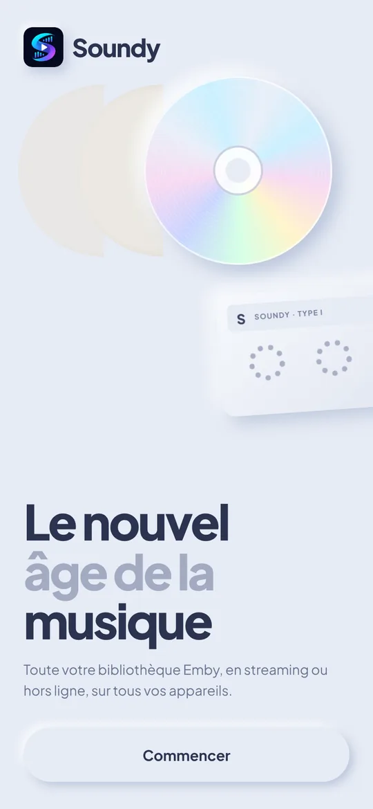<br><sub>Accueil</sub></td>
    <td align="center">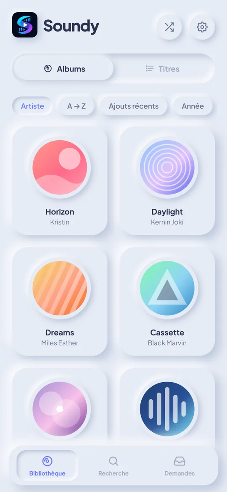<br><sub>Bibliothèque (albums)</sub></td>
    <td align="center">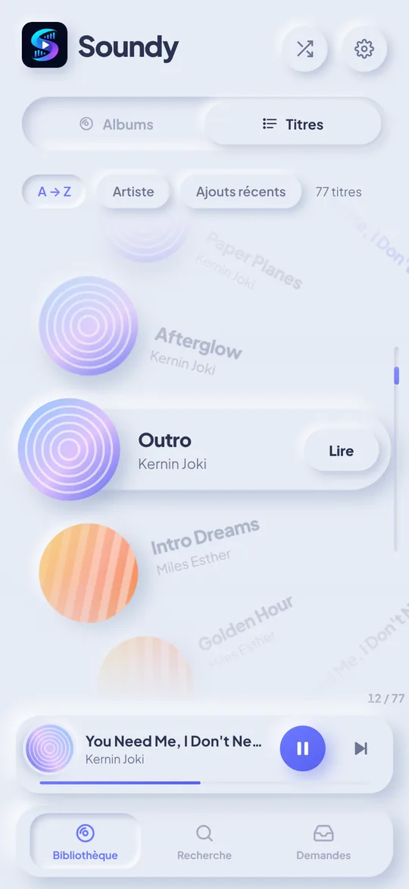<br><sub>Titres en roue</sub></td>
    <td align="center">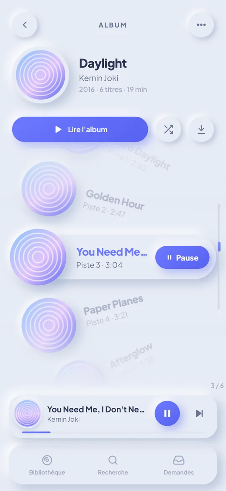<br><sub>Album</sub></td>
  </tr>
  <tr>
    <td align="center">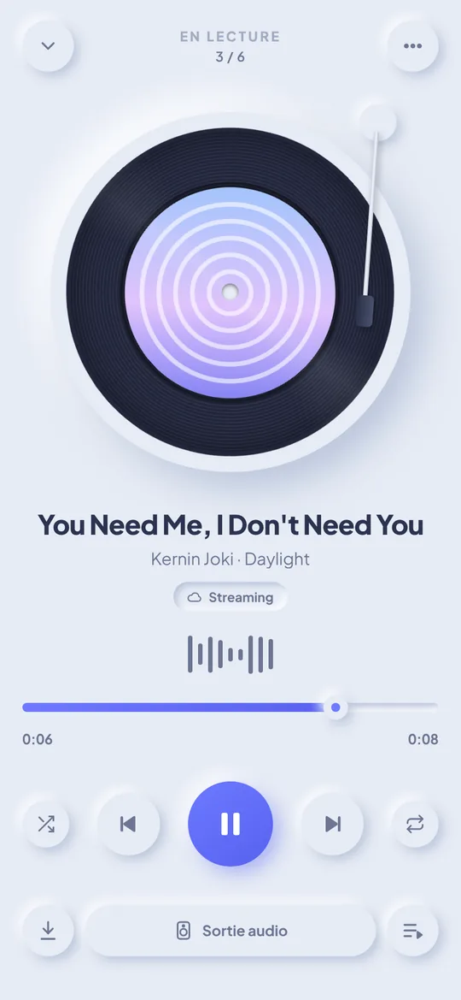<br><sub>Lecteur</sub></td>
    <td align="center">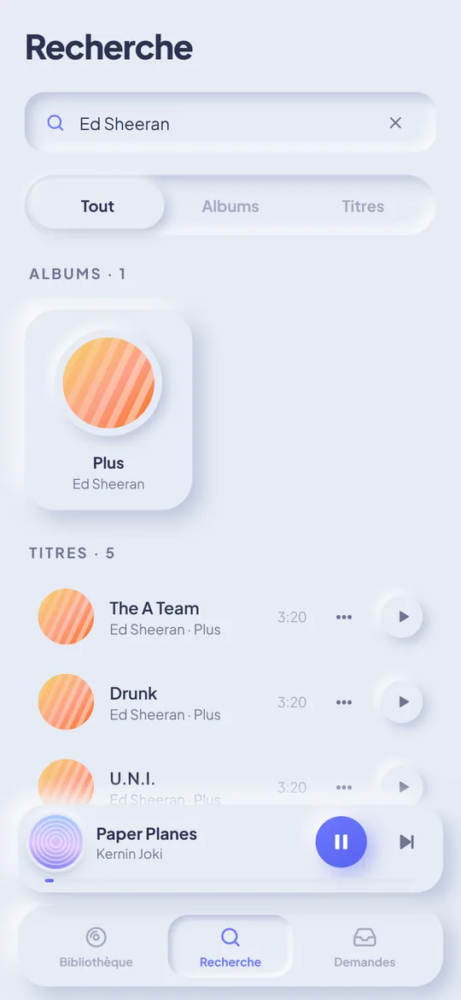<br><sub>Recherche (artiste)</sub></td>
    <td align="center">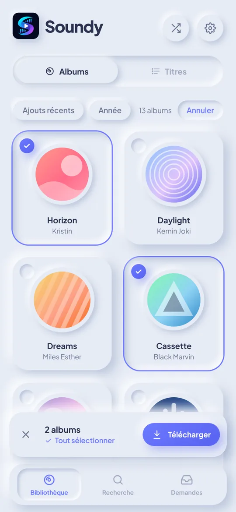<br><sub>Sélection d'albums</sub></td>
    <td align="center">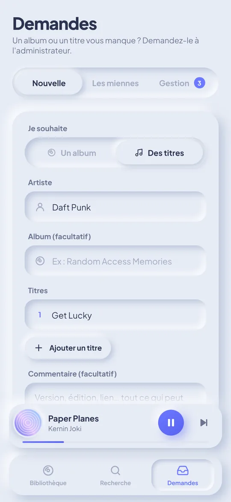<br><sub>Demandes d'ajout</sub></td>
  </tr>
  <tr>
    <td align="center">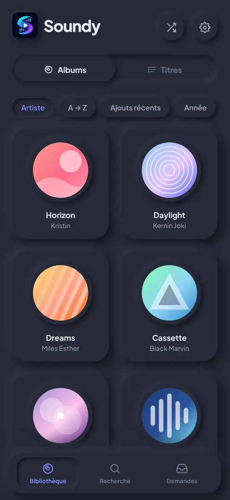<br><sub>Thème sombre</sub></td>
    <td align="center">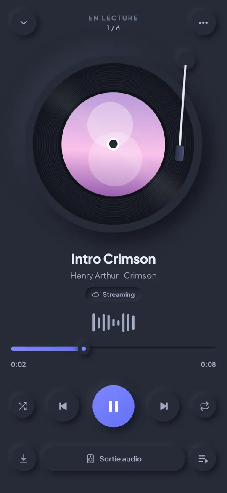<br><sub>Lecteur (sombre)</sub></td>
    <td></td>
    <td></td>
  </tr>
</table>

### Web (ordinateur)

<p align="center">
  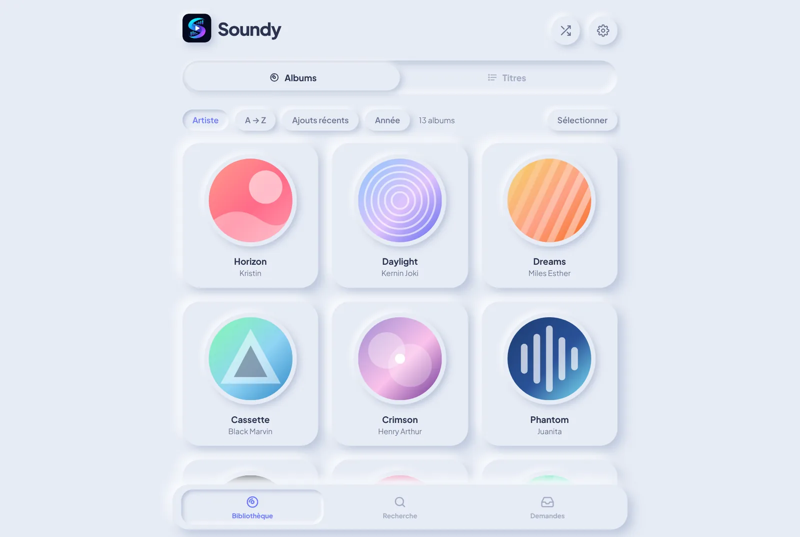<br><sub>Bibliothèque</sub>
</p>
<p align="center">
  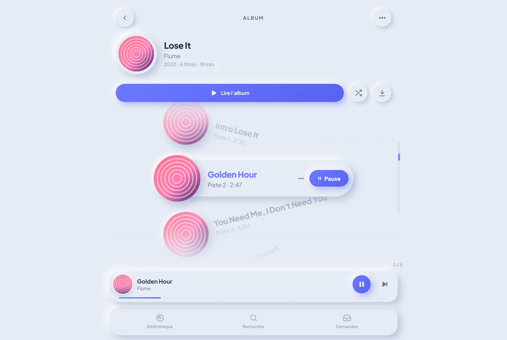
  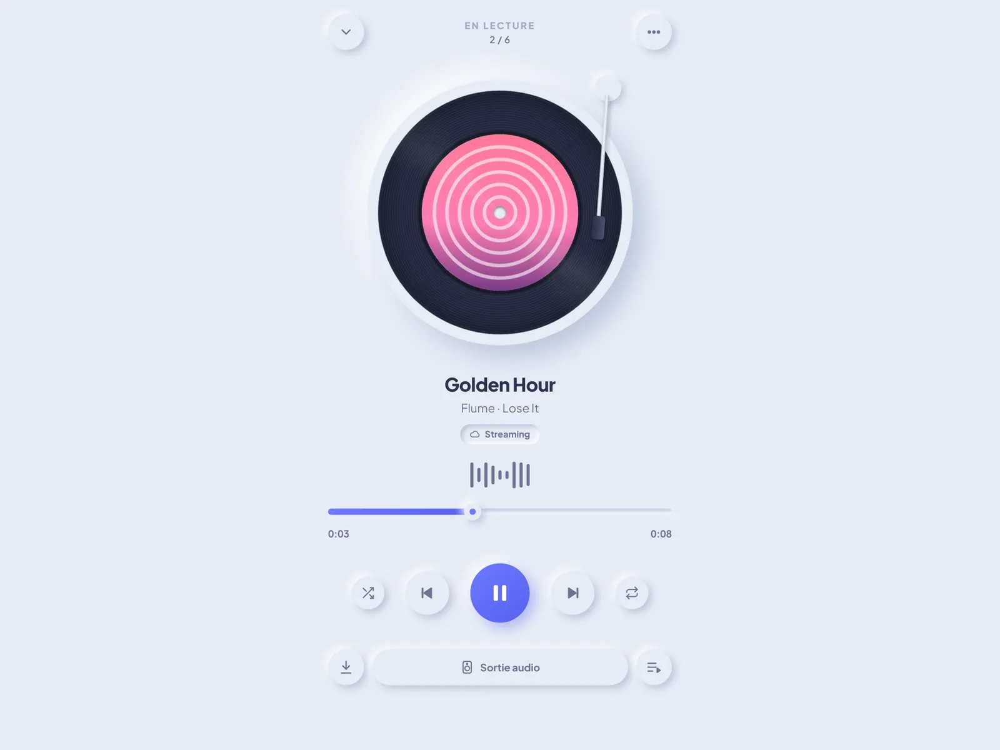
</p>
<p align="center"><sub>Album (navigation à la molette / aux flèches) &nbsp;·&nbsp; Lecteur plein écran</sub></p>

> Captures réalisées avec une bibliothèque de démonstration.

---

## ✨ Fonctionnalités

| Fonction | Détail |
|---|---|
| 🎵 Streaming Emby | Lecture de toute la bibliothèque musicale Emby, qualité réglable (sans perte → 128 kb/s). |
| 📥 Téléchargement | Sur chaque album / titre, ou **plusieurs albums d'un coup** (bouton *Sélectionner* ou appui long). **Un titre téléchargé est toujours lu depuis l'appareil en priorité**, même connecté. Espace utilisé et suppression dans les Réglages. |
| 💿 Bibliothèque | **Albums par défaut**, rangés **par artiste puis par ordre alphabétique**, ou vue **titre par titre**. Les albums « éclatés » par Emby (artiste de l'album différent selon les pistes) sont **réunis automatiquement**. |
| 🎡 Navigation en roue | Dans un album et dans la vue Titres, les morceaux défilent sur un cercle, le titre centré est mis en avant. **PC** : molette / trackpad, flèches, Page ↑/↓, Début/Fin, Entrée. **Mobile** : glisser au doigt. Menu d'un titre : clic droit / appui long. |
| ❤ Favoris | Par **titre** et par **album** (❤ dans la page album, la roue, le lecteur et le menu d'un titre) ; filtre **« Favoris »** dans la bibliothèque. Ce sont les favoris d'**Emby** : synchronisés avec vos autres appareils et applis Emby. |
| 🔍 Recherche | Par **album**, par **titre** et par **artiste** (filtres Tout / Albums / Titres), recherches récentes. |
| 🎧 Bluetooth | Casque / enceinte Bluetooth, nom de l'appareil connecté (Android), choix de la sortie (navigateur), boutons du casque / de la voiture. Lecture **écran éteint** avec notification de contrôle (Android). |
| 📳 Vibrations | Petit retour haptique en défilant les titres et sur les boutons (désactivable). |
| 📨 Demandes | Demander à l'admin l'ajout d'**un album entier** ou de **plusieurs titres** ; l'admin les valide / refuse avec un message. Notification Discord / Slack / Gotify possible. |
| 🌍 Langues | **Français et anglais**, au choix dès le premier lancement, modifiable dans les Réglages et sur l'écran de connexion. |
| 🌗 Thème | Clair, sombre ou automatique, style neumorphique. |
| 🔄 Mises à jour | Release GitHub automatique à chaque nouvelle version ; l'APK s'installe **par-dessus** la précédente (téléchargements conservés). |

---

<a id="nouveautes"></a>

## 🆕 Nouveautés

| Version | Changements |
|---|---|
| **1.4.0** | **Favoris** par titre et par album (synchronisés avec Emby), filtre « Favoris » dans la bibliothèque (albums et titres). |
| **1.3.0** | **Version anglaise** de l'appli : choix de la langue au premier lancement, dans les Réglages et sur l'écran de connexion (interface, notification Android, messages d'erreur du serveur). README en anglais. |
| **1.2.2** | Nouveau logo (icônes, écran de démarrage, en-tête). Défilement tactile rétabli quand le doigt commence sur une carte d'album. |
| **1.2.1** | Plus d'effet d'étirement / de rebond en haut et en bas des pages. |
| **1.2.0** | Vibrations douces (roue, boutons, appuis longs). Page Demandes corrigée dans l'appli Android (saisie de l'adresse du serveur sur la page). Écran de démarrage net, connexion sans défilement, mini lecteur et boutons du lecteur plus aérés, bras de la platine sur le vinyle, albums rangés par artiste. |
| **1.1.0** | Albums éclatés réunis, sélection et téléchargement de plusieurs albums, recherche par artiste, bouton retour d'Android, fondu adouci sous l'en-tête, **APK signé avec une clé fixe** (mises à jour sans perte des téléchargements). |
| **1.0.0** | Première version : streaming Emby, téléchargements hors ligne, navigation en roue, lecteur vinyle, Bluetooth, demandes d'ajout, PWA et APK Android. |

---

## 🔑 Identifiants

**Il n'y a pas d'identifiants par défaut** : Soundy n'a pas de comptes propres.
On se connecte avec un **compte utilisateur Emby** :

| Champ | Valeur |
|---|---|
| Adresse du serveur Emby | L'URL d'Emby, ex. `https://emby.mondomaine.fr` (Soundy essaie aussi `…/emby` automatiquement) |
| Identifiant | Votre nom d'utilisateur Emby |
| Mot de passe | Votre mot de passe Emby |

- Un **administrateur Emby** est automatiquement administrateur dans Soundy (onglet *Demandes → Gestion*).
- Pour ajouter un utilisateur : créez-le dans Emby (*Tableau de bord → Utilisateurs*), rien à faire dans Soundy.
- Pour qu'il puisse télécharger : cochez **« Autoriser le téléchargement de médias »** dans ses droits Emby.

---

## 🧱 Architecture

```
┌──────────────────────┐        ┌───────────────────────────┐
│  Soundy (web/Android)│──API──▶│  Emby (musique, pochettes)│
│  React + Vite        │        └───────────────────────────┘
│  IndexedDB (hors     │                     ▲ vérifie le jeton
│  ligne)              │──API──▶┌────────────┴──────────────┐
└──────────────────────┘        │  Serveur Soundy (Node.js) │
                                │  - API des demandes       │
                                │  - héberge l'app web      │
                                │  - proxy Emby (option)    │
                                └───────────────────────────┘
```

- **Connexion** : chaque utilisateur se connecte avec **son compte Emby**. Les administrateurs Emby sont automatiquement administrateurs dans Soundy (gestion des demandes).
- **Demandes** : stockées dans `data/requests.json` sur le serveur Soundy. Le serveur vérifie chaque requête auprès d'Emby : personne ne peut se faire passer pour un autre utilisateur.
- **Téléchargements** : stockés dans le navigateur / la WebView (IndexedDB), avec les pochettes.

```
src/
  api/emby.ts          Client de l'API Emby (connexion, albums, titres, recherche, flux audio)
  api/requests.ts      Client de l'API des demandes
  i18n/                Traductions (fr.ts, en.ts) — la compilation échoue s'il manque une clé anglaise
  store/player.ts      Lecteur (file d'attente, aléatoire, répétition, lecture locale prioritaire, MediaSession)
  store/downloads.ts   Gestionnaire de téléchargements (file, progression, stockage)
  lib/db.ts            Stockage IndexedDB (audio, pochettes, métadonnées)
  lib/nativeBridge.ts  Liaison avec le service Android (notification, boutons Bluetooth)
  lib/albums.ts        Regroupement des albums « éclatés » par Emby
  lib/haptics.ts       Vibrations (retour haptique)
  lib/backButton.ts    Bouton retour d'Android
  components/TrackWheel.tsx  Navigation en roue (molette, clavier, glisser)
  pages/               Bibliothèque, Album, Lecteur, Recherche, Demandes, Réglages, choix de la langue
  styles/global.css    Design system neumorphique (thèmes clair / sombre)
server/index.js        Serveur Soundy (Express)
android/               Projet Android (Capacitor) + plugin natif SoundyAudio
```

---

<a id="installation-coolify"></a>

## ☁️ Installation sur Coolify

1. **+ New → Resource → Private Repository (with GitHub App)** (ou *Public Repository*), choisissez le dépôt `Soundy`, branche **`main`**.
2. **Build Pack** : `Dockerfile` (le `Dockerfile` à la racine est détecté).
3. **Ports Exposes** : `8080`.
4. **Domains** : par exemple `https://soundy.mondomaine.fr` (Coolify génère le certificat HTTPS).
5. **Environment Variables** :
   - `EMBY_URL` = adresse de votre Emby, ex. `https://emby.mondomaine.fr` (ou `http://emby:8096` si Emby est sur le même réseau Docker) — **obligatoire** ;
   - facultatif : `WEBHOOK_URL`, `EMBY_PROXY=true`, `MAX_PENDING` ;
   - facultatif, en **Build Variable** : `VITE_EMBY_URL` pour pré-remplir l'adresse Emby sur l'écran de connexion.
6. **Storages** → *Add* → volume monté sur **`/data`** (conserve les demandes entre les déploiements).
7. **Health Check** (facultatif) : chemin `/api/health`, port `8080`.
8. **Deploy**, puis ouvrez le domaine et connectez-vous avec un compte Emby.

> Avec Coolify, l'application web et l'API des demandes sont sur le même domaine : rien à régler dans
> *Réglages → Serveur de demandes* côté web. Pour l'APK Android, renseignez `https://soundy.mondomaine.fr`.

## 🚀 Installation (Docker Compose)

Sur la machine qui héberge Emby (ou une autre) :

```bash
git clone https://github.com/PetitOursManu/Soundy.git
cd Soundy
```

Éditez `docker-compose.yml` (au minimum `EMBY_URL`), puis :

```bash
docker compose up -d --build
```

Soundy est alors disponible sur `http://IP_DU_SERVEUR:8080`.
Placez-le derrière votre reverse proxy HTTPS (Nginx Proxy Manager, Traefik, Caddy…), par exemple sur `https://soundy.mondomaine.fr`.

### Variables d'environnement du serveur

| Variable | Obligatoire | Description |
|---|---|---|
| `EMBY_URL` | ✅ | Adresse d'Emby **vue depuis le serveur Soundy** (ex. `http://emby:8096` ou `https://emby.mondomaine.fr`). Sert à vérifier les utilisateurs. |
| `PORT` | | Port d'écoute (défaut `8080`). |
| `DATA_DIR` | | Dossier des demandes (défaut `/data` dans Docker). |
| `CORS_ORIGINS` | | Origines autorisées (défaut `*`, nécessaire pour l'application Android). |
| `WEBHOOK_URL` | | URL appelée à chaque nouvelle demande (Discord, Slack, Mattermost, Gotify…). |
| `EMBY_PROXY` | | `true` pour exposer Emby via `https://soundy.mondomaine.fr/emby` (voir dépannage). |
| `MAX_PENDING` | | Nombre max de demandes en attente par utilisateur (défaut `20`). |

### Sans Docker

```bash
npm install
npm run build
EMBY_URL=http://localhost:8096 node server/index.js
```

---

## 📱 Application Android

### Option 1 — Release GitHub (le plus simple)

Ouvrez la page **Releases** du dépôt et téléchargez `Soundy-vX.Y.Z.apk` depuis le téléphone.
Une nouvelle Release est publiée automatiquement à chaque nouvelle version arrivée sur `main` :
il suffit d'augmenter `"version"` dans `package.json` (ex. `1.2.0` → `1.3.0`).

### Option 1 bis — APK de test (chaque push)

Le workflow GitHub Actions `.github/workflows/android.yml` compile l'APK à chaque push :

1. Sur GitHub, ouvrez l'onglet **Actions** → workflow **Android APK** → dernière exécution.
2. Téléchargez l'artefact **soundy-apk** (fichier zip contenant `app-debug.apk`).
3. Copiez l'APK sur le téléphone et installez-le (autorisez « sources inconnues »).

> 💡 Dans *Settings → Secrets and variables → Actions → Variables*, vous pouvez définir
> `SOUNDY_EMBY_URL` (adresse Emby pré-remplie) et `SOUNDY_REQUESTS_URL`
> (adresse du serveur Soundy, ex. `https://soundy.mondomaine.fr`) pour qu'ils soient intégrés à l'APK.

### Signature de l'APK (mises à jour sans perte des téléchargements)

Pour qu'une mise à jour s'installe **par-dessus** l'ancienne version (et conserve les titres
téléchargés), chaque APK doit être signé avec la **même clé**. Elle est fournie au workflow
par deux secrets du dépôt (*Settings → Secrets and variables → Actions → New repository secret*) :

| Secret | Contenu |
|---|---|
| `SOUNDY_KEYSTORE_BASE64` | Le fichier de clé `.jks` encodé en base64 (une seule ligne) |
| `SOUNDY_KEYSTORE_PASSWORD` | Le mot de passe de la clé (alias `soundy`) |

Sans ces secrets, l'APK est compilé avec une clé temporaire et **aucune Release n'est publiée**.
⚠️ Ne publiez jamais la clé ni son mot de passe (le dépôt est public) et gardez-en une copie :
si elle est perdue, la mise à jour suivante obligera à désinstaller l'appli une fois.

Créer une nouvelle clé (si besoin) :

```bash
keytool -genkeypair -keystore soundy-release.jks -storetype PKCS12 -alias soundy -keyalg RSA -keysize 2048 -validity 10000
```

```bash
base64 -w0 soundy-release.jks
```

### Option 2 — Android Studio

```bash
npm install
npm run android:sync    # compile le web et le copie dans android/
npm run android:open    # ouvre le projet dans Android Studio
```

Puis *Build → Build APK(s)*.

### Particularités Android

- **Lecture en arrière-plan** : un service affiche une notification « Lecture en cours » avec les contrôles ; la musique continue écran éteint.
- **Bluetooth** : le lecteur affiche le nom de l'appareil Bluetooth connecté et un bouton ouvre directement les réglages Bluetooth d'Android. Les boutons du casque, de l'enceinte ou de la voiture pilotent Soundy.
- **Serveur de demandes** : à la première ouverture de l'onglet *Demandes*, indiquez l'adresse de votre serveur Soundy (celle de la version web). Modifiable ensuite dans *Réglages → Serveur de demandes*.
- **Bouton retour** : ferme la fenêtre ou la sélection ouverte, revient à l'écran précédent, puis met l'appli en arrière-plan (la musique continue).
- **Vibrations** : retour haptique du système (suit le réglage de vibration du téléphone), désactivable dans *Réglages → Vibrations*.
- **Langue** : français ou anglais, choisi au premier lancement ; la notification de lecture suit la langue choisie.
- **Mises à jour** : installez le nouvel APK par-dessus l'ancien, les titres téléchargés sont conservés.
- Un serveur Emby en `http://` (réseau local) est accepté.

---

## 🛠️ Développement

```bash
npm install
cp .env.example .env         # facultatif
npm run server &             # API des demandes sur :8080 (EMBY_URL à définir)
npm run dev                  # application sur http://localhost:5173 (proxy /api → :8080)
```

### Ajouter ou modifier un texte

Tous les textes sont dans `src/i18n/fr.ts` (référence) et `src/i18n/en.ts`. Ajoutez la clé dans les deux
fichiers : la compilation TypeScript échoue s'il manque une traduction anglaise.

---

## ❓ Dépannage

**« Impossible de joindre le serveur Emby » à la connexion**
- Vérifiez l'adresse (avec `https://`). Soundy essaie automatiquement le suffixe `/emby`.
- Si Soundy est en `https://`, Emby doit aussi être en `https://` (le navigateur bloque le contenu mixte).
- Si votre Emby/reverse proxy bloque les requêtes « CORS », activez `EMBY_PROXY=true` et utilisez comme adresse de serveur dans Soundy : `https://soundy.mondomaine.fr/emby`.

**Le téléchargement échoue (erreur 403)**
Dans Emby → *Utilisateurs* → *(utilisateur)* → cochez **« Autoriser le téléchargement de médias »**.

**L'onglet Demandes affiche « Service de demandes indisponible »**
Vérifiez que le serveur Soundy tourne (`/api/health`) et, sur Android, que son adresse est renseignée dans les réglages.

**Choix de la sortie audio dans le navigateur**
Le sélecteur d'appareil (casque, enceinte Bluetooth…) est disponible sur Chrome/Edge (ordinateur) et Firefox. Sur téléphone, connectez simplement l'appareil Bluetooth au système : Soundy l'utilise automatiquement.
